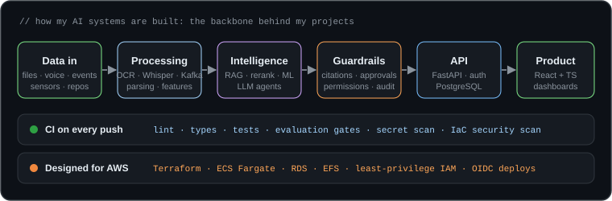

<div align="center">





<br/>

<a href="#-projects"></a>
<a href="#-how-i-build"></a>
<a href="#-education"></a>
<a href="#-roles-im-open-to"></a>
<a href="https://www.linkedin.com/in/israel-rocklyn-789884140/"></a>

<br/><br/>


<p align="center">
<a href="#-featured-project">Featured</a> ·
<a href="#-how-i-build-systems">Architecture</a> ·
<a href="#-projects">Projects</a> ·
<a href="#-roles-im-open-to">Roles</a> ·
<a href="#-stack">Stack</a> ·
<a href="#-education">Education</a> ·
<a href="#-digital-marketing--wordpress-toolkit">Marketing &amp; WordPress</a> ·
<a href="#-lets-build-something">Contact</a>
</p>

</div>

---

> [!TIP]
> **Recruiter summary (20 seconds)**
> - **Who:** AI, ML & Cloud Engineer and Full-Stack Developer, who also builds WordPress sites and runs digital marketing.
> - **Education:** M.S. Computer Science (concentration in Artificial Intelligence) · B.Sc. Information Systems.
> - **Proof:** 23 production-grade projects with tests, CI and **measured results**, from RAG and LLM agents to ML models and an AWS landing zone.
> - **Strengths:** shipping end to end (data → model → API → UI → infrastructure), honest evaluation, and security by default.
> - **Status:** available for hire, based in the United States. Start with the [featured project](#-featured-project).

### ⚡ Currently

- ✅ **Just shipped** [`distributed-ai-inference`](https://github.com/codeROCK-IZZY/distributed-ai-inference): a Go inference gateway with admission control, tenant isolation and failover on Kubernetes
- ✅ **Also new** [`aws-mlops-platform`](https://github.com/codeROCK-IZZY/aws-mlops-platform): promotion gates, drift-triggered retraining and SageMaker canary deploys
- 💬 **Ask me about** RAG that cites its sources, guarding LLM agents with human approval, telling real model drift from noise, and testing infrastructure without an AWS account

---

```python
class Rocklyn(AIEngineer, MLEngineer, CloudEngineer, FullStackDeveloper):
    """I build AI products and the cloud platforms they run on: end to end, tested, documented."""

    roles     = ["AI Engineer", "ML Engineer", "LLM / GenAI Engineer", "MLOps Engineer",
                 "Cloud & Platform Engineer", "Full-Stack Developer"]
    languages = ["Python", "TypeScript", "SQL", "HCL", "PHP"]
    education = {"M.S. Computer Science": "concentration in Artificial Intelligence",
                 "B.Sc. Information Systems": "technology in service of the business"}

    def builds(self):
        return {
            "ai":        ["grounded RAG with citations", "LLM agents with human approval",
                          "speech + vision + OCR pipelines", "classical ML with explainability"],
            "backend":   ["FastAPI services", "PostgreSQL (pgvector, job queues)", "Kafka streaming"],
            "frontend":  ["React + TypeScript dashboards"],
            "cloud":     ["AWS landing zones", "ECS / RDS / EFS", "Terraform with tests"],
            "web":       ["WordPress (Elementor, Divi, ACF)", "WooCommerce and Shopify stores"],
            "growth":    ["SEO", "GA4 + Tag Manager analytics", "Google and Meta Ads", "email and CRM"],
        }

    def principles(self):
        return [
            "Measure it: AI features ship with an evaluation, not a demo.",
            "Say \"I don't know\": answers cite their source or decline.",
            "Secure by default: least privilege, no long-lived keys, audit trails.",
            "Write it down: design docs, runbooks and known limitations in every repo.",
        ]
```

## ⭐ Featured project

<table>
<tr>
<td width="55%" valign="top">
<a href="https://github.com/codeROCK-IZZY/multimodal-ai-assistant"></a>
</td>
<td width="45%" valign="top">

### [Multimodal AI Assistant](https://github.com/codeROCK-IZZY/multimodal-ai-assistant)

Ask about a **receipt photo, a scanned PDF or a voice memo** by typing or speaking. Every answer quotes
its source with the **page, line or timestamp**. When the files don't contain the answer, it says so.

- 🎙️ Whisper speech-to-text and Piper voice replies, **all on CPU**
- 🔎 Two-stage retrieval: embeddings, then a **cross-encoder** that decides answerability
- 🛡️ Tools behind a permission gate that **prompt injection can't bypass**
- 🧪 Evaluation suite enforced in CI: OCR, speech, Q&A, tools, injection

[**See the code →**](https://github.com/codeROCK-IZZY/multimodal-ai-assistant)

</td>
</tr>
</table>

<p align="center">
<a href="https://github.com/codeROCK-IZZY/multimodal-ai-assistant"></a>
<a href="https://github.com/codeROCK-IZZY/autonomous-business-platform"></a>
<a href="https://github.com/codeROCK-IZZY/ai-predictive-maintenance"></a>
</p>

## 🏗️ How I build systems



## 🚀 Projects

<table>
<tr>
<td width="50%" valign="top">

### 🔁 [AWS MLOps Platform](https://github.com/codeROCK-IZZY/aws-mlops-platform)
Keeps a production model healthy **after** it ships: data contracts, MLflow registry, **promotion gates** against the champion, drift and performance monitoring that **retrains by itself**, and SageMaker **canary deploys with auto-rollback**.

📊 Every drift detected **in its first month** · **0/12** false alarms · PR-AUC **0.64 vs 0.58** unmanaged

`MLflow` `SageMaker` `XGBoost` `Terraform` `FastAPI` `React`

</td>
<td width="50%" valign="top">

### 🗣️ [Multimodal AI Assistant](https://github.com/codeROCK-IZZY/multimodal-ai-assistant)
Talk or type, attach photos, PDFs and voice notes. Answers cite the **page, line or timestamp**, decline when the files don't say, and run tools under permissions that **prompt injection can't bypass**.

📊 **92%** grounded-answer accuracy · **4%** speech WER · **0** prompt-injection data changes

`faster-whisper` `Piper TTS` `RapidOCR` `cross-encoder` `FastAPI` `React`

</td>
</tr>
<tr>
<td valign="top">

### ☁️ [Enterprise AWS Cloud Platform](https://github.com/codeROCK-IZZY/enterprise-aws-cloud-platform)
A Terraform **landing zone**: Organizations with guardrail SCPs, tamper-resistant org-wide logging, GuardDuty and Security Hub, and a Transit Gateway network with prod/non-prod isolation. **Tested without an AWS account**.

📊 **32** Terraform tests on a mocked provider · **0** Checkov failures · AWS quotas checked before plan

`Terraform` `AWS Organizations` `Transit Gateway` `IPAM` `Checkov`

</td>
<td valign="top">

### 🤖 [Autonomous Business Operations](https://github.com/codeROCK-IZZY/autonomous-business-platform)
AI agents that handle refunds, supplier invoices and purchase requests, with **human approval** for risky actions, idempotent tools, retries and a **hash-chained audit trail**.

📊 **96.9%** correct outcomes on 129 labelled cases · **100%** approval precision and recall

`LangGraph` `Claude API` `PostgreSQL` `FastAPI` `React`

</td>
</tr>
<tr>
<td valign="top">

### 💳 [Fraud Detection Engine](https://github.com/codeROCK-IZZY/fraud-detection-engine)
Real-time fraud scoring on a **Kafka** transaction stream, with explainable model decisions and an analyst case workflow.

📊 Catches **93%** of fraud dollars at ~31 alerts/day · **96%** precision in the critical band

`Kafka` `XGBoost` `SHAP` `FastAPI` `React`

</td>
<td valign="top">

### 📄 [Intelligent Document AI](https://github.com/codeROCK-IZZY/intelligent-document-ai)
Turns PDFs, Word files and scans into searchable, structured data, with **grounded Q&A** that refuses to answer without a citation.

📊 Retrieval recall@5 **1.0** · field extraction **100%** · OCR error rate **1.6%**

`OCR` `pgvector` `embeddings` `Claude citations` `FastAPI`

</td>
</tr>
<tr>
<td valign="top">

### 🏭 [AI Predictive Maintenance](https://github.com/codeROCK-IZZY/ai-predictive-maintenance)
Predicts industrial equipment failures days ahead from sensor data, explains each prediction, and tracks the fleet on a dashboard.

📊 Flagged **34 of 35** held-out failures, **6.6 days** ahead on average · precision **0.83**

`scikit-learn` `XGBoost` `SHAP` `FastAPI` `React`

</td>
<td valign="top">

### 🔎 [AI Research & Knowledge Engine](https://github.com/codeROCK-IZZY/ai-research-engine)
Team knowledge bases built from files and the web, with hybrid search, re-ranking and cited answers.

📊 Citation precision **99.3%** · **100%** correct "not found" · MRR **1.0** with re-ranking

`pgvector` `ONNX re-ranker` `hybrid search` `FastAPI`

</td>
</tr>
<tr>
<td valign="top">

### 🧠 [AI Developer Intelligence](https://github.com/codeROCK-IZZY/ai-developer-intelligence)
Understands any codebase: parses five languages, maps dependencies, flags risks and answers questions about the code.

📊 **100%** precision and recall on 21 planted findings · semantic search recall@5 **95%**

`tree-sitter` `PageRank` `MinHash` `pgvector` `FastAPI`

</td>
<td valign="top">

### ⚡ [Distributed AI Inference](https://github.com/codeROCK-IZZY/distributed-ai-inference)
Model serving that **stays predictable under overload**: a Go gateway with per-tenant quotas, **admission control** (Little's law), deadlines, fan-out and failover, in front of batching ONNX workers on **Kubernetes**.

📊 Overload: **38.6 vs 0.05** req/s served · noisy neighbour: **98.7% vs 23.8%** · replica killed: **0** errors

`Go` `Kubernetes` `KEDA` `ONNX Runtime` `Prometheus`

</td>
</tr>
<tr>
<td valign="top">

### ⚡ [AWS Serverless Event Platform](https://github.com/codeROCK-IZZY/aws-serverless-event-platform)
Event-driven order processing with **exactly-once effects under at-least-once delivery**: an idempotent API, a transactional outbox, and a Step Functions saga that compensates. A fault-injection evaluation removes each mechanism to **measure what it prevents**.

📊 **0** invariant violations under **566** injected faults · **68** double charges prevented · **$130** per million orders

`Lambda` `Step Functions` `DynamoDB` `EventBridge` `SQS` `Terraform`

</td>
<td valign="top">

### 🛡️ [AWS Security Guardrails](https://github.com/codeROCK-IZZY/aws-security-guardrails)
Detect AWS misconfigurations **as they happen** (CloudTrail → EventBridge), fix the safe ones behind exemptions, a re-check, a **circuit breaker** and an exact **rollback**, and find **IAM privilege-escalation paths**, not just wildcards.

📊 **100%** precision/recall on 446 labelled findings (string matching: **19.5%**) · **0** unintended changes in 237 fixes

`Python` `Lambda` `EventBridge` `Security Hub` `IAM` `Terraform`

</td>
</tr>
<tr>
<td valign="top">

### 💰 [AWS FinOps Optimizer](https://github.com/codeROCK-IZZY/aws-finops-optimizer)
Cost recommendations you can act on, from **CUR 2.0**: waste with evidence, rightsizing on **peaks not averages**, the **provably optimal Savings Plan**, backtested forecasts and anomalies that respect the weekly cycle.

📊 **31.8%** of a $115k/month run rate identified · **0** unsafe downsizes (average-CPU rule: **77**) · **0** false anomaly alarms (vs **33**)

`Python` `DuckDB` `Athena` `CloudWatch` `AWS Budgets` `Terraform`

</td>
<td valign="top">

### 🏞️ [AWS Data Lakehouse](https://github.com/codeROCK-IZZY/aws-data-lakehouse)
Bronze/silver/gold that gets the numbers right when the feed does not: **data contracts** with quarantine, **idempotent MERGE**, late data, schema evolution, and snapshots with **time travel** and lineage.

📊 **$0.00** revenue error on $19.1M (naive append: **$2.24M**) · **942/942** bad rows quarantined · **0** snapshots on replay

`Python` `DuckDB` `Parquet` `S3` `Glue` `Athena` `Terraform`

</td>
</tr>
<tr>
<td valign="top">

### 🌍 [AWS Resilience Lab](https://github.com/codeROCK-IZZY/aws-resilience-lab)
Multi-region **disaster recovery measured**: the four AWS DR strategies compared on RTO, RPO and cost, and a **guarded failover controller** (quorum, error-rate alarm, hysteresis, fencing) against a naive one.

📊 **3.4 min** RTO p95 active-active (backup and restore: **105 min**) · **0** split-brain writes (naive: **19,082**) · **0/20** false failovers

`Python` `NumPy` `Route 53` `DynamoDB` `S3 CRR` `AWS FIS` `Terraform`

</td>
<td valign="top">

### 🛡️ [LLM Guardrails Gateway](https://github.com/codeROCK-IZZY/llm-guardrails-gateway)
A security gateway in front of any LLM: **prompt-injection detection** (including hidden in documents and obfuscated), **PII redaction and restoration**, output checks for leaks and phishing links, rate limits and budgets.

📊 **0%** attack success (no gateway: **100%**, keywords: **91%**) · **90%** of hand-written attacks caught · **3.1 ms** p95

`Python` `scikit-learn` `FastAPI` `Docker` `Claude API`

</td>
</tr>
<tr>
<td valign="top">

### 📏 [LLM Evaluation Platform](https://github.com/codeROCK-IZZY/llm-evaluation-platform)
Evaluation that holds up: judges **calibrated against human labels** (kappa), **debiased pairwise judging**, paired tests with Holm correction, and a **slice-aware release gate** with measured false alarms and power.

📊 kappa **0.91** vs humans (uncalibrated **0.51**) · **96%** of slice regressions blocked at **2.5%** false alarms · overall-mean gate: **1.5%**

`Python` `NumPy` `SciPy` `Statistics`

</td>
<td valign="top">

### 🎯 [Recommender System](https://github.com/codeROCK-IZZY/recommender-system)
Recommendations measured honestly: **EASE, implicit ALS, BPR and item-kNN** against popularity on a **temporal split**, tuned on validation, a **cold-start hybrid**, and a serving API.

📊 **+29%** NDCG over popularity (CI +0.034 to +0.043) · cold-start NDCG **2.8x** · a random split flatters by **65%**

`Python` `NumPy` `SciPy` `FastAPI`

</td>
</tr>
<tr>
<td valign="top">

### 📈 [Demand Forecasting](https://github.com/codeROCK-IZZY/demand-forecasting)
Hierarchical, probabilistic forecasting: a **global quantile GBM**, **conformal intervals**, bottom-up / WLS / **MinT reconciliation**, a rolling backtest, and **costed stock decisions**.

📊 **36%** less error than seasonal naive · coverage **72% → 81.8%** for an 80% interval · stock cost **−51%**

`Python` `scikit-learn` `NumPy`

</td>
<td valign="top">

### 🧬 [Entity Resolution](https://github.com/codeROCK-IZZY/entity-resolution)
Which records are the same person: **multi-key blocking**, a **learned matcher** with nickname- and typo-aware features, and **average-linkage clustering** that won't chain look-alikes together.

📊 F1 **0.986** on unseen people (rules **0.930**) · **4.9x** fewer errors · twins merged **1.3%** (connected components: **33%**)

`Python` `scikit-learn` `NumPy`

</td>
</tr>
<tr>
<td valign="top">

### 🧪 [Experimentation Platform](https://github.com/codeROCK-IZZY/experimentation-platform)
A/B tests that keep their promises: **CUPED**, an **always-valid sequential test** for teams that peek, **SRM checks**, the **delta method** and **FDR control**, all measured on simulated experiments.

📊 peeking: **26.6%** false positives → **0.7%** · CUPED **−22%** variance · slicing false finds **36% → 4.6%**

`Python` `NumPy` `SciPy`

</td>
<td valign="top">

### 🗄️ [Feature Store](https://github.com/codeROCK-IZZY/feature-store)
Training sets that see what serving sees: **point-in-time joins** as known at each moment, an **online store that matches offline exactly**, and **skew detection**, with the leakage it prevents measured.

📊 **0** of 44,000 rows differ from serving · label-date leak: AUC **1.00 offline → 0.71** in production · pence bug caught on **4/4** amount features

`Python` `NumPy` `scikit-learn`

</td>
</tr>
<tr>
<td valign="top">

### 🔍 [Visual Anomaly Detection](https://github.com/codeROCK-IZZY/visual-anomaly-detection)
Unsupervised defect detection on CPU: a **PatchCore-style patch memory** with a **greedy coreset**, trained on good parts only, against pixel statistics and PCA, with **image and pixel AUROC** per defect.

📊 AUROC **0.974** (pixel stats **0.847**, PCA **0.764**) · **77%** of defects caught at ~4% false alarms · **43 ms** per image

`Python` `NumPy` `SciPy` `scikit-learn`

</td>
<td valign="top">

</td>
</tr>
</table>


## 🎯 Roles I'm open to

<p align="center">


</p>

| If you need… | Look at |
|---|---|
| **AI / LLM engineering:** RAG, agents, evaluation, guardrails | [Multimodal Assistant](https://github.com/codeROCK-IZZY/multimodal-ai-assistant) · [Business Agents](https://github.com/codeROCK-IZZY/autonomous-business-platform) · [Document AI](https://github.com/codeROCK-IZZY/intelligent-document-ai) · [Guardrails Gateway](https://github.com/codeROCK-IZZY/llm-guardrails-gateway) · [Evaluation Platform](https://github.com/codeROCK-IZZY/llm-evaluation-platform) · [Visual Anomaly Detection](https://github.com/codeROCK-IZZY/visual-anomaly-detection) |
| **Machine learning:** models that explain themselves | [Predictive Maintenance](https://github.com/codeROCK-IZZY/ai-predictive-maintenance) · [Fraud Detection](https://github.com/codeROCK-IZZY/fraud-detection-engine) · [Recommender System](https://github.com/codeROCK-IZZY/recommender-system) · [Demand Forecasting](https://github.com/codeROCK-IZZY/demand-forecasting) · [Entity Resolution](https://github.com/codeROCK-IZZY/entity-resolution) · [Experimentation Platform](https://github.com/codeROCK-IZZY/experimentation-platform) |
| **MLOps:** registry, gated promotion, drift monitoring, retraining | [AWS MLOps Platform](https://github.com/codeROCK-IZZY/aws-mlops-platform) · [Feature Store](https://github.com/codeROCK-IZZY/feature-store) |
| **Model serving and distributed systems:** load shedding, quotas, failover, Kubernetes | [Distributed AI Inference](https://github.com/codeROCK-IZZY/distributed-ai-inference) |
| **Search and developer tools** | [Research Engine](https://github.com/codeROCK-IZZY/ai-research-engine) · [Developer Intelligence](https://github.com/codeROCK-IZZY/ai-developer-intelligence) |
| **Cloud and platform engineering** | [Enterprise AWS Cloud Platform](https://github.com/codeROCK-IZZY/enterprise-aws-cloud-platform) · [Serverless Event Platform](https://github.com/codeROCK-IZZY/aws-serverless-event-platform) · [Security Guardrails](https://github.com/codeROCK-IZZY/aws-security-guardrails) · [FinOps Optimizer](https://github.com/codeROCK-IZZY/aws-finops-optimizer) · [Data Lakehouse](https://github.com/codeROCK-IZZY/aws-data-lakehouse) · [Resilience Lab](https://github.com/codeROCK-IZZY/aws-resilience-lab) |

## 🎓 Education

<table>
<tr>
<td width="50%" valign="top">

### M.S. Computer Science
**Concentration: Artificial Intelligence**

Graduate-level focus on artificial intelligence and machine learning: the foundation behind the AI
systems in the projects above.

</td>
<td width="50%" valign="top">

### B.Sc. Information Systems
**Business technology and data**

How technology serves a business: the reason my projects start from a real business problem and end
with documentation for the people who run them.

</td>
</tr>
</table>

## 🧰 Stack

| | |
|---|---|
| **AI & ML** |          |
| **Backend** |       |
| **Frontend** |     |
| **Cloud & DevOps** |         |
| **Web & growth** |      <a href="#-digital-marketing--wordpress-toolkit">full toolkit ↓</a> |

## 🧪 How I build

```yaml
every_repo:
  ci:             [lint, type-check, tests, secret scan]          # green on main, every repo
  ai_features:    measured on labelled evaluation sets            # accuracy, citations, abstention, safety
  security:       least-privilege IAM, no long-lived credentials, input validation, audit trails
  infrastructure: Terraform for AWS, validated in CI, never applied without review
  docs:           [README, design doc, operations runbook, known limitations, model / AI card]
  data:           synthetic only, generated by code, no real customer data
```

## 📣 Digital Marketing & WordPress Toolkit

Besides engineering AI systems, I build and grow websites: WordPress builds, SEO, analytics, campaigns
and e-commerce. I can ship a product **and** help it reach the right people.

<table>
<tr><td><b>🧱 WordPress & page builders</b></td><td>     </td></tr>
<tr><td><b>🧑‍💻 Web development</b></td><td>   </td></tr>
<tr><td><b>🔍 SEO & site optimization</b></td><td>       </td></tr>
<tr><td><b>📈 Analytics & tracking</b></td><td>      </td></tr>
<tr><td><b>📣 Marketing platforms</b></td><td>        </td></tr>
<tr><td><b>🛒 E-commerce & payments</b></td><td>    </td></tr>
<tr><td><b>🎨 Design & creative</b></td><td>   </td></tr>
<tr><td><b>🌐 Hosting, performance & accessibility</b></td><td>    </td></tr>
<tr><td><b>🗂️ Workflow & AI</b></td><td>      </td></tr>
</table>

```js
const marketing = {
  wordpress:   "business sites with Elementor, Gutenberg, Divi or WPBakery; ACF and PHP for custom features",
  seo:         "technical audits, keyword research and Core Web Vitals fixes that move rankings",
  analytics:   "GA4, Tag Manager and Looker Studio dashboards; heatmaps and A/B tests for conversion",
  campaigns:   "Google Ads, Meta, email (Mailchimp, HubSpot, Constant Contact) and CRM automation",
  ecommerce:   "WooCommerce and Shopify stores with Stripe, PayPal and Square payments",
  quality:     "fast, secure, accessible (WCAG 2.1 / 2.2) sites on managed hosting with CDN and SSL",
};
```

<!-- Contribution snake (regenerated daily by .github/workflows/snake.yml). Re-enable once the graph fills in:
## 🐍 Contribution activity

<picture>
  <source media="(prefers-color-scheme: dark)" srcset="https://raw.githubusercontent.com/codeROCK-IZZY/codeROCK-IZZY/output/github-snake-dark.svg"/>
  <source media="(prefers-color-scheme: light)" srcset="https://raw.githubusercontent.com/codeROCK-IZZY/codeROCK-IZZY/output/github-snake.svg"/>
  
</picture>

-->

---

<div align="center">

### 🤝 Let's build something

**Hiring for AI, ML, cloud or full-stack work?** Start with the [featured project](#-featured-project);
every README opens with the problem, the design and the measured results.

<a href="https://israelrocklyn.info"></a>
<a href="https://www.linkedin.com/in/israel-rocklyn-789884140/"></a>


<sub>Built in public, one production-grade project at a time.</sub>

</div>
